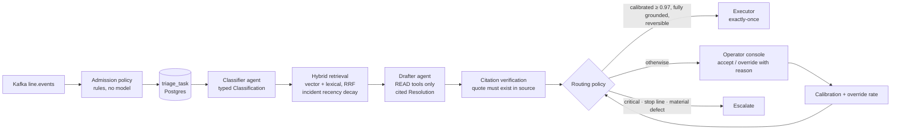

# Anomaly Desk

**A multi-agent first pass for manufacturing anomaly triage: a typed classifier, hybrid retrieval over procedures and past incidents, a drafting agent with read-only tools and verified citations, a routing policy that only auto-applies what's calibrated and reversible — and a judge harness held up against operator overrides.**

A production line streams machine events; a small fraction are anomalies that a human desk triages. This system does the first pass and leaves the decision where it belongs. Its distinguishing concern is measurement honesty: an LLM judge can report a high score while operators keep overriding the system, so the project puts both numbers side by side and treats the gap between them as the real signal.



## Design highlights

- **Cheap gate before expensive reasoning.** The Kafka consumer applies explicit admission rules in code and durably records triage tasks; it never calls a model, so it keeps up with the stream and the agent layer can restart without replaying the topic.
- **Structured outputs downstream code actually reads.** The classifier returns a Pydantic `Classification`; the drafter returns a `Resolution` with proposed actions, open questions, and citations.
- **Citations are claims you can check.** A `Citation` names a source, revision, section, and quoted span. `retrieval/grounding.py` loads the cited document and verifies the quote is really there (with normalization and fuzzy window matching). A response with no citations scores 0, not 1.
- **Hybrid retrieval for two kinds of query terms.** Vector search catches "oven too hot" ≈ thermal runaway; lexical search catches exact codes like `F-THERM-OVER` and `SPX-MP-4412`. Results are fused with reciprocal rank fusion (k = 60), and incident relevance decays with a 240-day half-life.
- **The agent can't change anything.** Tools are READ or WRITE; write tools are never callable from the agent path. The drafter only *proposes* actions, and a single executor applies approved ones exactly once using idempotency keys.
- **Routing is pure and conservative.** Critical severity, stop-line dispositions, and material defects always escalate. Auto-apply requires calibrated accuracy ≥ 0.97 (from what operators actually did at that stated confidence, not what the model claims), a 100% citation grounding rate, no open questions, only reversible actions, and a monotone calibration curve. Every applicable reason is reported, not just the first.
- **Prompt injection defended structurally.** Retrieved text is wrapped so it can't close its own wrapper, proposed actions are checked against scope, and summaries are length-capped. The tests assert these properties rather than hoping the model refuses.
- **Overrides become labels.** The operator console makes accept a one-click path and requires a reason category and note to override, so normal work produces a labeled dataset.
- **Two scoreboards.** Offline judge scores and production override rates are rendered per anomaly class. The judge is validated against expert labels (Cohen's κ), rollouts are A/B tested on override rate, and the deploy gate blocks on *regression* against baseline rather than an absolute bar.
- **Traces that reconstruct a decision.** One span per agent hop with latency and cost (from versioned, date-effective pricing) and redaction; reports use percentiles, not means.

## Quick start

Requires Python 3.10+.

```bash
git clone https://github.com/AliAzamat/anomaly-desk-applied-ai.git
cd anomaly-desk-applied-ai
pip install pytest pydantic

python -m pytest -q desk/redteam    # 9 structural injection-boundary tests
```

The other entry points are the stream consumer (`python -m desk.ingest.consumer`, configured with `KAFKA_BOOTSTRAP` and `TOPIC_LINE_EVENTS`) and the deploy gate (`python -m desk.gate.check <candidate.json> <baseline.json> <judge_agreement.json>`). Schema migrations are in `desk/store/migrations/`.

## Layout

| Path | Purpose |
|---|---|
| `desk/ingest/` | Kafka consumer and admission policy |
| `desk/agents/` | Classifier, drafter, and READ/WRITE tool registry |
| `desk/schemas/` | Classification, Resolution, and Citation contracts |
| `desk/retrieval/` | Hybrid retriever and citation grounding verification |
| `desk/routing/` | Confidence calibration, routing policy, exactly-once executor |
| `desk/judge/` | Rule graders, model judge, judge validation, two-scoreboard report |
| `desk/redteam/` | Authored adversarial cases, defenses, boundary tests |
| `desk/gate/` | Regression gate and A/B analysis on override rate |
| `desk/ops/` | Tracing, pricing, latency/cost reports |
| `desk/api/review.py` | Operator API: queue, evidence, accept, override |
| `desk/store/` | Postgres access and migrations |
| `console/src/AnomalyDesk.tsx` | Operator console |
| [docs/WHAT_THE_GATE_MISSES.md](docs/WHAT_THE_GATE_MISSES.md) | Known blind spots of the evaluation gate |
